  
  
  
  
  

## ❯ work

| Project | Description | Stack |
| :--- | :--- | :--- |
| [horizon](https://github.com/wiyw/horizon) | Minecraft: Java Edition in Rust, checked against vanilla with 281 differential harnesses | `Rust` `WGSL` `GLSL` |
| [jb-research](https://github.com/wiyw/jb-research) | iOS 27.0.1 → 27.2 patch diffing, CVE mapping, Ghidra artifacts | `C` `arm64e` |
| [SekaiPop](https://github.com/wiyw/SekaiPop) | Project Sekai themed Quickshell rice | `QML` `GLSL` `Lua` |
| [sekaipop-omdrop](https://github.com/wiyw/sekaipop-omdrop) | Omdrop plugin for SekaiPop | `QML` `JavaScript` |

<a href="https://github.com/wiyw?tab=repositories">all repositories →</a>

## ❯ activity

 

 

greyson@mac ~ % exit logout

