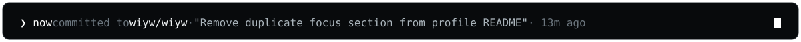
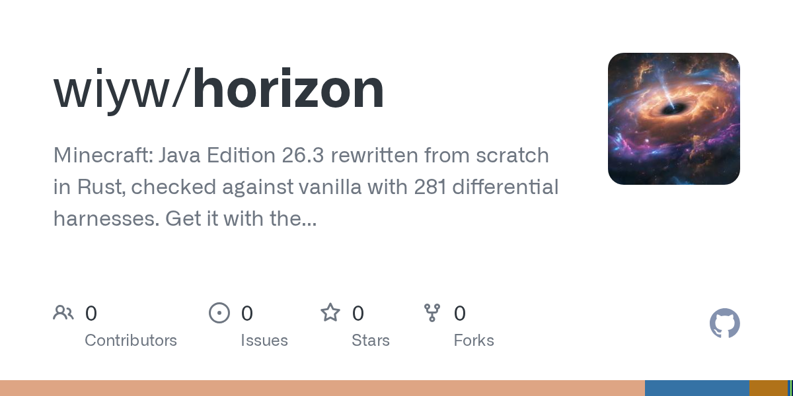
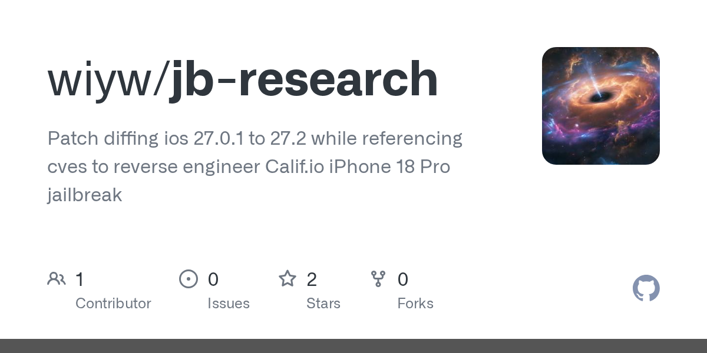
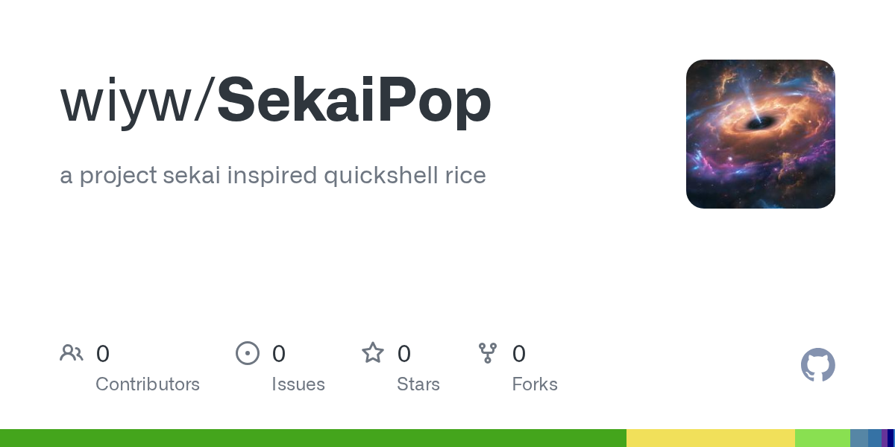
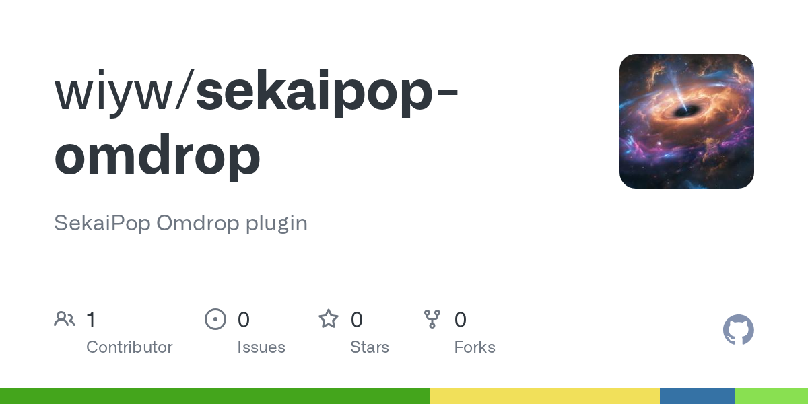
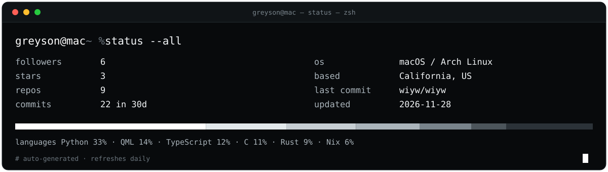

## ❯ work

<table>
<tr>
<td width="50%"></td>
<td width="50%"></td>
</tr>
<tr>
<td width="50%"></td>
<td width="50%"></td>
</tr>
</table>

<a href="https://github.com/wiyw?tab=repositories">all repositories →</a>

greyson@mac ~ % exit logout

