<div align="center">


<p>
  
  
  
  
  
</p>

</div>

## ❯ cat about.md

Most of my work happens on a Mac now: Rust on Horizon, iOS firmware diffs, and fixing whatever I broke in my Quickshell setup. Arch is still around — separate box, used for Wayland experiments and anything I don't want touching my daily driver.

```text
greyson@mac ~ % uname -a
Darwin greysons-mac 25.2.0 arm64

greyson@mac ~ % ssh archbox
greyson@archbox ~ % uname -a
Linux archbox 6.18.8-arch1-1 x86_64 GNU/Linux
```

## ❯ ./now --status

<div align="center">


</div>

- **Horizon** — mostly Rust. I've been helping close gaps against vanilla and running the differential checks.
- **jb-research** — the iOS side: diffing 27.0.1 against 27.2, pulling dylibs out of the shared cache.
- **SekaiPop** — my Quickshell rice. Still test it on the Arch box before I call it done.
- Currently reading about allocators and `arm64e` signing.

<div align="center">


</div>

## ❯ man disciplines

| Reverse Engineering | Systems & Rust | Desktop & Daily Drivers |
| :--- | :--- | :--- |
| iOS diffs, CVE lookup, Ghidra, dyld shared cache, `arm64e` Mach-O | Rust engines, differential harnesses, allocator behavior, C utilities | macOS daily, Arch for experiments, Quickshell/QML, Hyprland on the Linux box |

<div align="center">


</div>

## ❯ cat focus.map

<div align="center">



</div>

<p align="center">
  
  
  
  
  
  
  
  
  
</p>

## ❯ ls -1 projects/

| Project | What it is | Stack |
| :--- | :--- | :--- |
| [horizon](https://github.com/wiyw/horizon) | Minecraft: Java Edition rewritten in Rust, checked against vanilla with 281 differential harnesses | `Rust` `WGSL` `GLSL` |
| [jb-research](https://github.com/wiyw/jb-research) | Patch diffing iOS 27.0.1 → 27.2, CVE references, Ghidra output | `C` `arm64e` |
| [SekaiPop](https://github.com/wiyw/SekaiPop) | Project Sekai themed Quickshell rice | `QML` `GLSL` `Lua` |
| [sekaipop-omdrop](https://github.com/wiyw/sekaipop-omdrop) | Omdrop plugin for SekaiPop | `QML` `JavaScript` |
| [nixos-config](https://github.com/wiyw/nixos-config) | Interstellar themed NixOS config | `Nix` |

<p align="center">
  <a href="https://github.com/wiyw?tab=repositories">view all repositories →</a>
</p>

<div align="center">


</div>

## ❯ ./telemetry.sh

<div align="center">


<br />


<br />


</div>

<div align="center">


<p><sub>greyson@mac ~ % exit<br />logout</sub></p>

</div>
