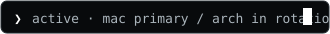

<div align="center">




<p>
  
  
  
  
  
</p>

</div>

## ◤ Signal

I build systems and I take them apart. These days my time splits between rewriting Minecraft: Java Edition from scratch in **Rust**, reversing **iOS firmware** diffs down to the Mach-O and kext layer, and tuning a Wayland desktop until every pixel earns its place. The through-line is the same: understand the whole stack, then own it.

```text
$ whoami --verbose

name        Greyson
role        Systems engineer · reverse engineer
location    California, US
focus       Rust · C · arm64e · QML · Wayland
research    iOS patch diffing · CVE correlation · memory safety
building    Horizon (MC:JE in Rust) · SekaiPop (Quickshell rice)
method      read the source, diff the binary, verify the behavior
offclock    orbital mechanics · deep-field images
```

## ◤ Now

<div align="center">



</div>

- Contributing to **Horizon** — a vanilla-accurate Minecraft: Java Edition engine in Rust, checked against the original with hundreds of differential harnesses.
- Reverse-engineering **iOS 27.0.1 → 27.2** in `jb-research`: IPSW extraction, dyld shared caches, Ghidra decompilation and version diff reports.
- Polishing **SekaiPop**, a Project Sekai–themed Quickshell rice, and its `omdrop` plugin.
- Reading up on allocator internals, `arm64e` code signing and the Wayland protocol.

<div align="center">


</div>

## ◤ Disciplines

| Reverse Engineering | Systems & Rust | Desktop Craft |
| :--- | :--- | :--- |
| • iOS patch diffing & CVE correlation<br>• Ghidra, `ipsw`, dyld shared cache<br>• Mach-O `arm64e`, kexts, decompilation<br>• Binary instrumentation & analysis | • Rust engine & tooling engineering<br>• Differential testing against vanilla<br>• Heap behavior & allocator internals<br>• Low-level C utilities | • QML overlays with Quickshell<br>• Hyprland / Wayland pipelines<br>• Declarative NixOS setups<br>• GLSL shaders & pixel-perfect theming |

<div align="center">


</div>

## ◤ Focus Map

<div align="center">


</div>

<p align="center">
  
  
  
  
  
  
  
  
  
</p>

## ◤ Selected Work

| Project | What it is | Stack |
| :--- | :--- | :--- |
| [horizon](https://github.com/wiyw/horizon) | Minecraft: Java Edition rewritten in Rust, validated against vanilla with 281 differential harnesses | `Rust` `WGSL` `GLSL` |
| [jb-research](https://github.com/wiyw/jb-research) | Patch diffing iOS 27.0.1 → 27.2, CVE references, Ghidra decompilation artifacts | `C` `arm64e` |
| [SekaiPop](https://github.com/wiyw/SekaiPop) | A Project Sekai–inspired Quickshell rice | `QML` `GLSL` `Lua` |
| [sekaipop-omdrop](https://github.com/wiyw/sekaipop-omdrop) | Omdrop plugin for the SekaiPop rice | `QML` `JavaScript` |
| [nixos-config](https://github.com/wiyw/nixos-config) | Interstellar-themed NixOS desktop configuration | `Nix` |

<p align="center">
  <a href="https://github.com/wiyw?tab=repositories">view all repositories →</a>
</p>

<div align="center">


</div>

## ◤ Telemetry

<div align="center">


<br />


<br />


</div>

<div align="center">


<p><sub>built with intent · broken with curiosity</sub></p>

<p>
  <a href="https://github.com/wiyw">GitHub</a> ·
  <a href="https://github.com/wiyw?tab=repositories">Repositories</a> ·
  <a href="https://github.com/wiyw/wiyw">Profile README source</a>
</p>

</div>
